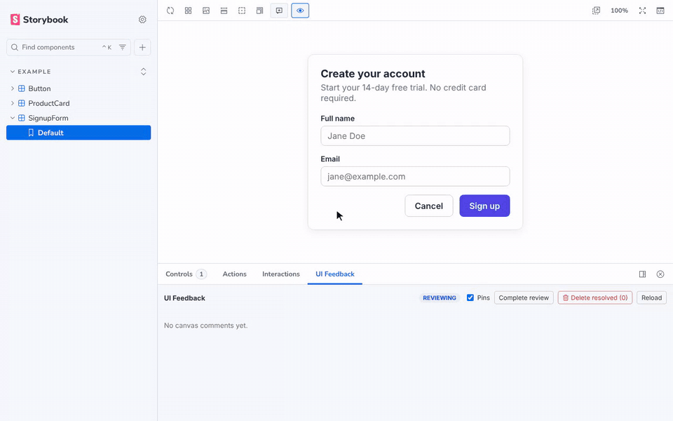
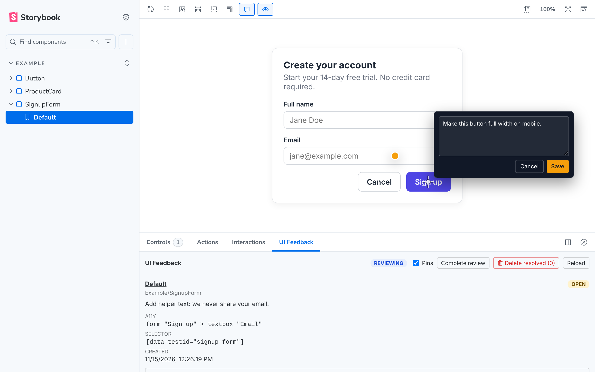
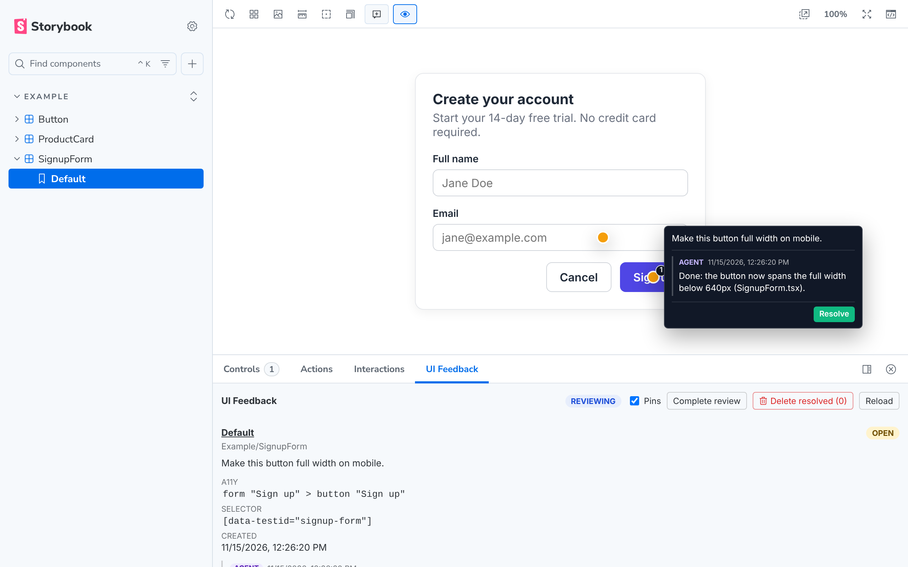
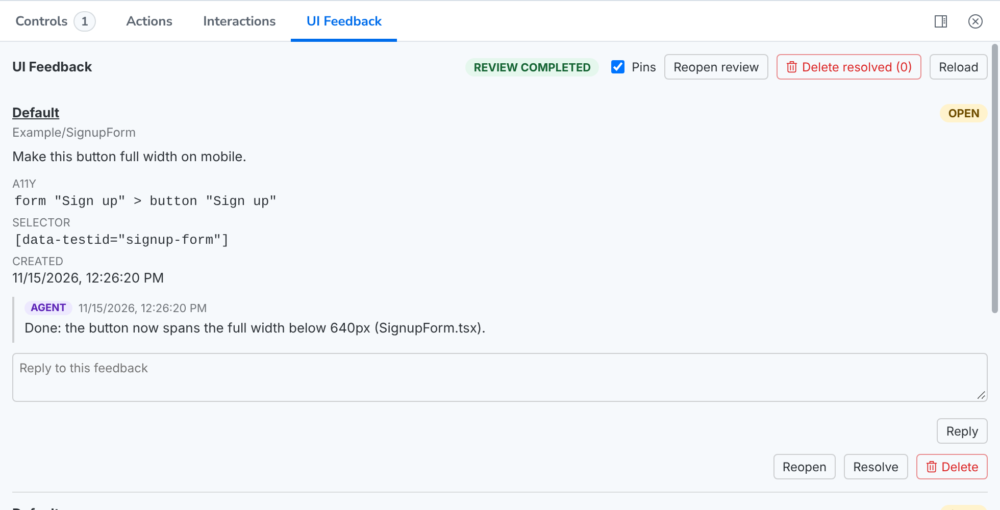
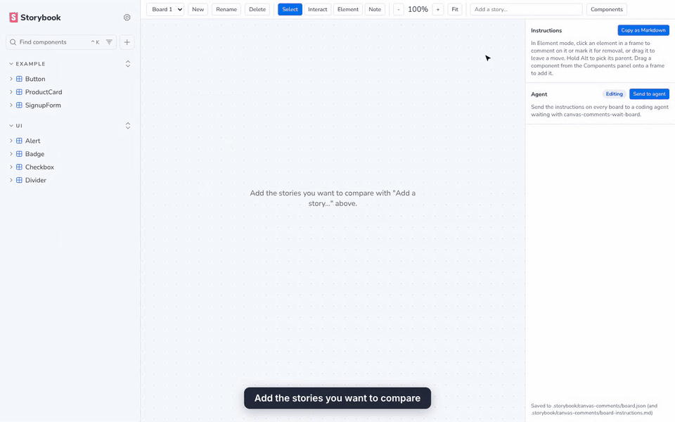
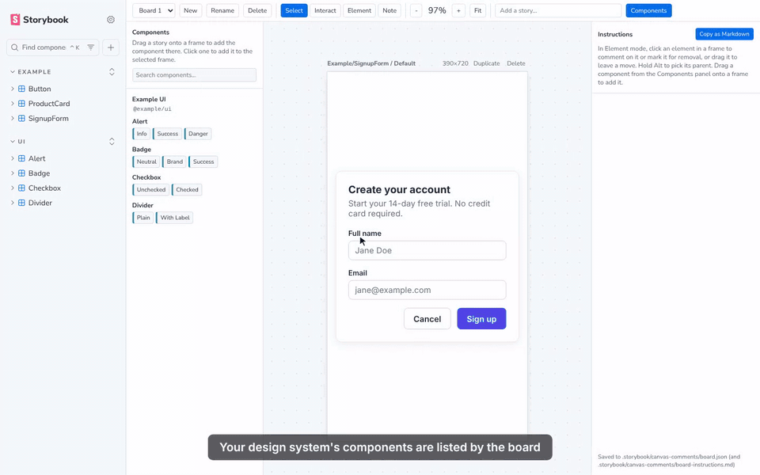

# storybook-addon-canvas-comments

A Storybook addon for leaving inline UI feedback comments directly on the canvas.
It is designed so that coding agents (AI assistants) can pick up the feedback and act on it.

Click any element in a story and type a note.
The comment is anchored to the element's role and accessible name in the accessibility tree.
A CSS selector and pointer coordinates are saved too, as fallbacks.
A DOM snapshot of the target element is saved with it too.
A companion CLI lets an agent block until you finish reviewing.
The agent then receives all open comments as structured JSON.

A **board** page lays several stories side by side, like a design canvas.
You can duplicate a frame, set its props, drag elements to where they should go, mark elements for removal, and leave notes.
You can also drop components from your design system onto a frame.
The board writes those instructions as Markdown for a coding agent.

## Demo



| Leave a comment | Read the thread on a pin | Review in the panel |
| --- | --- | --- |
|  |  |  |

1. Turn on **UI feedback** in the toolbar and click an element on the canvas. Type a note in the popover and save it.
2. Each comment becomes a pin. Hover a pin to read the note and its replies, such as one a coding agent posted with the `reply` CLI.
3. The **UI Feedback** panel lists every comment with its accessibility anchor and selector. **Complete review** signals a waiting agent.

The demo runs the example Storybook in [`examples/react-vite`](examples/react-vite).
The [Board](#board) section has a demo of the board page.

## Features

| Feature | What it does |
| --- | --- |
| Inline commenting | Toggle "UI Feedback" in the toolbar, click an element on the canvas, and type a note in the popover. |
| Comment pins | Saved comments are shown as pins on the canvas. Hover or focus a pin to read the note and its replies, and resolve it in place. A pin with replies shows the reply count. Toggle pin visibility from the toolbar (eye icon) or the panel header. |
| Addon panel | A "UI Feedback" panel lists all comments with their selector and metadata. It supports reopen / resolve / delete, and deleting every resolved comment at once. |
| Replies | Each comment has a reply thread. Reviewers reply from the panel. Coding agents reply with the `reply` CLI to explain what they changed. The thread is shown in the panel and in the pin tooltip. |
| Review-completion signal | A "Complete review" button in the panel flips a review status flag. A waiting coding agent can detect it. "Reopen review" flips it back. |
| Agent-friendly output | The `dom-map` and `wait-comments` CLIs pair each comment with its saved DOM snapshot. They emit JSON built for LLM consumption. |
| Board | A board page (`/?path=/board/`) lays stories out as frames to compare variants. Drag elements in a frame to leave move instructions, mark them for removal, comment on them, and put notes on the board. Drag components from a design system onto a frame to show what to add. The instructions are written as Markdown for coding agents. See [Board](#board). |

## Requirements

- Storybook with the **Vite builder**. Webpack builders are not supported.
  The addon preset registers a Vite dev-server middleware via `viteFinal`.
- React-based manager UI (standard Storybook 8+).

## Installation

Install the package from npm as a dev dependency:

```bash
pnpm add -D storybook-addon-canvas-comments
# or
npm install -D storybook-addon-canvas-comments
# or
yarn add -D storybook-addon-canvas-comments
```

The release workflow builds `dist/` and ships it in the npm package.
The package has no install-time scripts (`preinstall`, `install`, `postinstall`, or `prepare`).
So pnpm needs no `allowBuilds` entry for it.

## Setup

Register the addon in `.storybook/main.ts`:

```ts
import type { StorybookConfig } from "@storybook/react-vite";

const config: StorybookConfig = {
  addons: ["storybook-addon-canvas-comments"],
};

export default config;
```

## Usage

1. Turn on **UI Feedback** in the Storybook toolbar.
2. Click the target UI element on the canvas.
3. Type your note in the popover (`Cmd/Ctrl+Enter` to save, `Escape` to cancel).
4. The comment appears in the **UI Feedback** addon panel.

Use the eye icon in the toolbar to show or hide the saved-comment pins on the canvas.
The **Pins** checkbox in the panel header does the same.
Hovering or focusing a pin shows the note as a tooltip with a resolve button.
The tooltip also lists the comment's replies, oldest first, with their author and date.
A long thread scrolls inside the tooltip, and the tooltip stays within the canvas.
A pin with replies shows the reply count as a badge.
Replies from the `reply` CLI appear after the story reloads.

Comments are stored under the directory where the Storybook dev server runs:

```text
.storybook/canvas-comments/comments.json
```

Resolved comments stay in this file until you delete them.
The **Delete resolved (N)** button in the panel header deletes all resolved comments in every story.
Their replies are deleted too.
Open comments are kept.

Treat this file as local feedback data. A coding agent can read the JSON directly, or use the CLIs below for DOM-mapped output.
Add the directory to `.gitignore`, because the [board](#board) saves its files next to it:

```gitignore
**/.storybook/canvas-comments/
```

## Review completion (coding-agent integration)

This workflow lets a coding agent that started Storybook detect when your review is finished.
The agent then moves on to follow-up work (fixes, filing issues, and so on).

1. Leave comments on the canvas.
2. When you are done, click the **Complete review** button in the panel header.
3. The review status becomes `completed`, signaling any waiting agent.

Adding a new comment automatically flips the status back to `reviewing`.
So the fix → re-review loop works repeatedly.

While the review is `completed`, the button reads **Reopen review**.
Click it to set the status back to `reviewing` without adding a comment.
Click **Complete review** again to signal a waiting agent once more.

The review status is stored in the same file as the comments, under `review`:

```json
{
  "comments": [],
  "review": {
    "status": "reviewing",
    "updatedAt": "2026-06-27T00:00:00.000Z"
  }
}
```

An agent can block until the review completes with the `wait-comments` CLI. On completion it prints the dom-map JSON of the open comments to stdout and exits:

```bash
pnpm exec canvas-comments-wait-comments \
  --comments-file path/to/.storybook/canvas-comments/comments.json \
  --include-dom-tree
```

On startup the CLI resets the review status to `reviewing` before polling.
So a stale `completed` from a previous round does not return immediately.
Pass `--no-reset` to skip the reset. Other options:

- `--timeout-ms <ms>` — give up after this long (exit code 1); `0` waits indefinitely (default).
- `--poll-interval-ms <ms>` — polling interval (default `2000`).
- `--status <open|resolved|all>` / `--story-id <id>` — filter which comments are included in the output.

## Board

The board compares stories side by side and collects fix instructions across them.
Open it at `/?path=/board/`, or press **+ Board** in the toolbar of a story to add that story and open the board.



The demo adds two SignupForm stories and duplicates one of them.
In the copy, it sets the `title` prop in the side panel, moves the **Sign up** button, marks the **Cancel** button for removal, and comments on the heading.
It then leaves a note and shows the Markdown the board writes for a coding agent.

| Action | How |
| --- | --- |
| Add a frame | Type in **Add a story…** at the top and press `Enter`, or press **+ Board** on a story. |
| Duplicate a frame | **Duplicate** in the frame header. Its instructions are copied too, so the copy can branch off as another variant. |
| Move and resize | Drag a frame by its header, or anywhere on it in Select mode. Drag the bottom-right corner to resize, or pick **Mobile** / **Tablet** / **Desktop** in the side panel. |
| Override args | Set the story's props in the side panel. Each prop gets an input for its type (a checkbox, a select of its options, a number or text field) with its type and default. **Reset** goes back to the story's value. **Raw args** takes Storybook's URL format, such as `label:Save;disabled:!true`, for what the inputs do not cover. |
| Pan and zoom | Drag the background or scroll to pan. `Ctrl` / `Cmd` + scroll zooms. **Fit** shows every frame. |
| Several boards | Pick a board in the toolbar, or use **New**, **Rename** and **Delete**. |

The board has four modes. Switch them in the toolbar or with a key:

| Mode | Key | What it does |
| --- | --- | --- |
| Select | `V` | Select, move and resize frames. |
| Interact | `I` | Use the stories as usual, for example to open a menu before you comment. |
| Element | `E` | Click an element in a frame to comment on it or mark it for removal. Drag it to leave a move instruction. |
| Note | `N` | Click the board to put a note. A note placed on a frame belongs to that frame. |

In Element mode, pressing an element picks its closest interactive ancestor (`button`, `a`, `[role]`, `[tabindex]` and so on).
So pressing the text inside a button picks the button.
Hold `Alt` to pick one level further out.
Each instruction gets a numbered pin, and moves are previewed inside the frame with a CSS `translate`.
To delete an element, click it and press **Remove element** on its instruction in the side panel.
The element is faded out in the frame and its pin turns red; press **Keep element** to undo.
The story code does not change; a coding agent or a person makes the real fix.

### Design system components

The board can list the components of a design system, such as a `@acme/ui` package in your monorepo.
Drag one onto a frame to show where it should go.
The board renders the component's story in place, and writes an instruction to add it, with its import, to the Markdown for coding agents.



The demo searches the **Components** panel of the example design system and drags an Alert above the sign-up form.
It drops a Checkbox on the form, sets its `label` and `defaultChecked` props in the side panel, and gives it a note.
It then moves the Alert and shows the Markdown the board writes for a coding agent.

List the design systems in the preset options.
Each one is a set of stories: the stories under a title prefix in this Storybook, or the stories of a [composed Storybook](https://storybook.js.org/docs/sharing/storybook-composition).
A library without stories works too; see [Libraries without stories](#libraries-without-stories).

```ts
// .storybook/main.ts
const config: StorybookConfig = {
  addons: [
    {
      name: "storybook-addon-canvas-comments",
      options: {
        designSystems: [
          // Stories in this Storybook whose title starts with "UI/"
          { name: "Example UI", importPath: "@example/ui", titlePrefix: "UI/" },
          // Every story of the Storybook composed as `refs.ui`
          { name: "@acme/ui", ref: "ui" },
        ],
      },
    },
  ],
  refs: {
    ui: { title: "@acme/ui", url: "http://localhost:6008" },
  },
};
```

| Option | Description |
| --- | --- |
| `name` | Shown in the **Components** panel. |
| `importPath` | The module written into the instructions, as in `import { Alert } from "@example/ui"`. Defaults to `name`. |
| `titlePrefix` | Only stories whose title starts with this. Leave it out to list every story. |
| `ref` | The id of a composed Storybook in `refs`. Leave it out for stories in this Storybook. |

With a design system set, the board toolbar has a **Components** button that shows or hides the panel.
The panel groups the stories by component, and each story is a variant you can drag:

- Drag a story onto a frame. The frame is highlighted while the pointer is over it.
  The component goes where you drop it, and takes the height of its rendered story.
- Click a story, or focus it and press `Enter`, to add it to the top-left of the selected frame (or of the first frame).
- Drag a placed component to move it, and drag its bottom-right corner to resize it.
- Select it to set its props in the side panel, with the same inputs as a frame's (or type **Raw args** in Storybook's URL format, such as `title:Saved`), and describe how to use it.

The component name comes from the last part of the story title.
`UI/Alert` gives `Alert`, and an auto title such as `buttons/primary-button` gives `PrimaryButton`.
When the component is dropped on an element of the story, the board records that element too, like an element instruction.

Stories of a composed Storybook render from its URL.
When that URL is on another origin, the board cannot read the rendered story.
So the component keeps the default 320×64 box and Storybook's own padding; resize it by hand.
The composed Storybook also has to allow the manager's origin with CORS, as for any composed Storybook.

#### Libraries without stories

A component library does not need stories of its own to be on the board.
Set `components`, and the preset writes a story for each component, which renders it with the args you give it on the board.

```ts
// .storybook/main.ts
const config: StorybookConfig = {
  addons: [
    {
      name: "storybook-addon-canvas-comments",
      options: {
        designSystems: [
          {
            name: "@acme/ui",
            // Every component the module exports
            components: "auto",
            // Exports to leave out of "auto"
            exclude: ["ThemeProvider"],
            // Args for the props a component cannot render without
            args: { Alert: { title: "Saved" } },
          },
        ],
      },
    },
  ],
};
```

| Option | Description |
| --- | --- |
| `components` | `"auto"` lists the components that `importPath` exports. An array, such as `["Alert", "Badge"]`, names them. |
| `exclude` | With `"auto"`, exports to leave out. |
| `args` | The args of a component's story, by component name. Each component has one story, `Default`. |

`"auto"` reads the module with TypeScript: its source, or its type declarations for a built package.
It lists the exports with a capitalized name that can be called or constructed, such as function components, `forwardRef` and `memo` components, and classes.
TypeScript has to be installed in the project; otherwise list the components.
`ref` and `titlePrefix` are ignored with `components`.

The stories are written under `node_modules/.cache/storybook-addon-canvas-comments/library/` in the directory where Storybook runs, each time Storybook starts.
They are tagged `canvas-comments-library`, so they are hidden from the sidebar, from docs pages and from the test runner, and the board's story search leaves them out.
They are still in `index.json`; leave them out of any tool that reads it, such as a visual regression test, by that tag.
They render in this Storybook with its decorators, such as a theme provider, and the board reads their props for the side panel when Storybook's docgen can read the component.

### Board instructions for coding agents

With the dev server, the board saves two files under the directory where Storybook runs:

```text
.storybook/canvas-comments/board.json             # the boards, frames, instructions and notes
.storybook/canvas-comments/board-instructions.md  # the instructions as Markdown
```

`board-instructions.md` is rewritten on every save, so an agent can read it as-is.
**Copy as Markdown** in the side panel copies the same Markdown for the current board.
Each element is identified by its role and accessible name, and by a CSS selector.
A frame's args follow its story id.
Moves, and the positions of components to add, are in the story's rendered CSS px:

```markdown
## Board 1

### Example/SignupForm / Default (copy)

- story: `example-signupform--default` / args: `title:Join the beta`
- size: 390×720

1. button "Sign up" (`#storybook-root > form > div:nth-of-type(3) > button:nth-of-type(2)`): move left 106px, move down 92px / Put Sign up on its own row, full width
2. button "Cancel" (`#storybook-root > form > div:nth-of-type(3) > button:nth-of-type(1)`): remove this element
3. heading "Join the beta" (`#storybook-root > form > h2`): Keep the title to one line

Components to add:

- Add `Checkbox` (`import { Checkbox } from "@example/ui"`, as in story `ui-checkbox--unchecked`, args `label:I agree to the Terms;defaultChecked:!true`) at x 62px, y 447px, 320×17, over form "Sign up" (`#storybook-root > form`) / Required before Sign up

### Board notes

- Ship the copy with the full-width button
```

A statically built Storybook has no dev-server API.
There the board saves to the browser's `localStorage`, so only that browser sees it.
Use **Copy as Markdown** to hand the instructions over.

The board reads each frame's DOM directly, so the manager and the preview must be served from the same origin.
That is the default for `storybook dev` and `storybook build`.
Every frame is a separate iframe, so keep a board to the stories you want to compare.
Keep the Storybook sidebar shown while you use the board.
With the sidebar hidden, Storybook places addon pages (and its own settings pages) in the wrong part of the window.

To leave out the board page and the **+ Board** button, turn the board off in the preset options:

```ts
const config: StorybookConfig = {
  addons: [
    {
      name: "storybook-addon-canvas-comments",
      options: { board: false },
    },
  ],
};
```

## Accessibility-tree anchor

On click, the addon walks up to the nearest element with a role and an accessible name.
An example is `button "Save"`.
It stores that element as `domContext.a11yAnchor`:

- `role` / `name` — the element's ARIA role and accessible name.
- `ancestors` — up to three named ancestors, outermost first, such as `group "Milk"`.
  They tell same-named elements apart.
- `index` — position among elements that still match role, name, and ancestors.
- `offset` — the click position inside the element's box, as a 0–1 ratio.

Roles and names come from [`dom-accessibility-api`](https://github.com/eps1lon/dom-accessibility-api).
Testing Library's `getByRole` uses the same library.
Pins on the canvas re-resolve the anchor whenever the story's layout or DOM changes.
So they follow the element when it moves or resizes.

Pins resolve their position in this order:

1. The accessibility-tree anchor.
2. The stored `selector`, only when it is an attribute or id selector.
   Positional path selectors are skipped.
3. The stored pointer, scaled from the original viewport.

The anchor is missing when no element up to `#storybook-root` has both a role and a name.
It no longer resolves after the element's accessible name changes.
In both cases the next fallback is used.
Anchors get more reliable when interactive elements and landmarks have a role and a label.
The same labels also help Testing Library queries.

## Selector strategy

Canvas Comments locates DOM elements using this priority:

1. `data-ai-source` — source file path (most precise, enables agent-to-source tracing)
2. `data-testid` — test ID attribute
3. `id` — element ID
4. Path selector — structural CSS selector (least stable)

The clicked element is first widened to the closest ancestor carrying one of those attributes.
So comments attach to meaningful components rather than leaf nodes.

The `data-ai-source` and `data-ai-component` attributes are the primary signals for AI agents.
Agents use them to locate source files from a comment.
As a starting convention, the addon exports a Vite plugin.
The plugin marks component files with metadata comments:

```ts
// .storybook/main.ts — viteFinal hook
import { canvasCommentsPlugin } from "storybook-addon-canvas-comments";

export const viteFinal = async (config) =>
  mergeConfig(config, {
    plugins: [canvasCommentsPlugin()],
  });
```

> **Note:** The bundled plugin currently provides metadata annotation as a foundation. For full JSX attribute injection (adding `data-ai-source` / `data-ai-component` to DOM elements at build time), integrate a Babel plugin or custom SWC transform. You can also add these attributes manually to component root elements.

The selector priority is fixed for now. Preset-level customization of the priority list may be added based on user feedback.

## HTTP API

With the Vite builder, the addon preset adds a middleware to the Storybook dev server:

```text
GET    /__canvas-comments/comments
POST   /__canvas-comments/comments
DELETE /__canvas-comments/comments?status=resolved
PATCH  /__canvas-comments/comments/:id
DELETE /__canvas-comments/comments/:id
POST   /__canvas-comments/comments/:id/replies
GET    /__canvas-comments/review
POST   /__canvas-comments/review
GET    /__canvas-comments/board
PUT    /__canvas-comments/board
```

`PATCH` updates a comment's `status` to `open` or `resolved`:

```json
{
  "status": "resolved"
}
```

`DELETE` removes the comment from `comments.json` and returns the deleted comment.

`DELETE /__canvas-comments/comments?status=resolved` removes every resolved comment.
It returns the deleted comments as an array.
Only `status=resolved` is accepted, and any other query returns `400`.
So open comments are never bulk-deleted.

`POST /__canvas-comments/comments/:id/replies` appends a reply and returns the updated comment.
`author` is `reviewer` or `agent`, and `body` must not be blank:

```json
{
  "author": "agent",
  "body": "Increased the padding to 16px"
}
```

A reply does not change the comment's `status`.
A `reviewer` reply resets the review status to `reviewing`, the same as a new comment.
An `agent` reply leaves the review status alone.

`GET /__canvas-comments/review` returns the current review state.
`POST` sets `status` to `reviewing` or `completed`:

```json
{
  "status": "completed"
}
```

`GET /__canvas-comments/board` returns the saved boards as `{ "version": 1, "boards": [...] }`.
`PUT` replaces them, writes `board.json`, and rewrites `board-instructions.md`.

Requests from the addon are sent with `Accept: msw/passthrough`.
So stories using `msw-storybook-addon` do not log unhandled-request warnings.
The requests pass straight through to the dev-server middleware.

## `dom-map` CLI

You can emit JSON for the saved comments with the `dom-map` CLI.
It reads `comments.json` from disk, or the hosted API with `--api-url`.
It pairs each comment with the DOM snapshot saved when the comment was created.
It needs neither a browser nor a running Storybook:

```bash
pnpm exec canvas-comments-dom-map \
  --comments-file path/to/.storybook/canvas-comments/comments.json \
  --story-id example-button--primary
```

Omitting `--story-id` processes every story that has comments. Only `open` comments are included by default.

```bash
pnpm exec canvas-comments-dom-map \
  --status all \
  --include-dom-tree
```

The output includes the stored anchor and coordinates.
It also includes the target element's tag / attributes / rect / text / ancestors.
Such comments get `matchType: "snapshot"`.
A comment without a snapshot gets `matchType: "none"` and an `error`.
With `--include-dom-tree` the subtree rooted at each comment target is also included.
That keeps the context small for AI agents.
Pass `--storybook-url` to fill the story URLs in the output.

## `reply` CLI

A coding agent can reply to a comment with the `reply` CLI to explain in plain words what it changed.
It writes to `comments.json` directly, so Storybook does not need to be running.
It prints the updated comment as JSON:

```bash
pnpm exec canvas-comments-reply \
  --comment-id 42f3dcbf-4e8d-49e4-86c4-7a61a62b7e70 \
  --body "Increased the padding to 16px" \
  --resolve
```

- `--author <agent|reviewer>` — who wrote the reply. Defaults to `agent`.
- `--resolve` — also mark the comment `resolved`. Without it, the status is unchanged.
- `--comments-file <path>` — override the default storage path.
- `--api-url <url>` — reply through the hosted API instead of a local file.

The `dom-map` and `wait-comments` output includes each comment's `replies`.
So the agent can read the earlier thread before it acts on a comment.

## JSON schema

Comments and the review status are stored in one JSON object, designed to be read by AI agents.
A file that only holds a comment array, from older versions, is still read:

```json
{
  "comments": [
    {
      "id": "42f3dcbf-4e8d-49e4-86c4-7a61a62b7e70",
      "storyId": "example-button--primary",
      "storyTitle": "Example/Button",
      "storyName": "Primary",
      "note": "Increase the padding around this button",
      "selector": "[data-ai-source=\"src/components/Button.tsx:42\"]",
      "dataTestId": "submit-button",
      "dataAiComponent": "SubmitButton",
      "dataAiSource": "src/components/Button.tsx:42",
      "rect": {
        "x": 24,
        "y": 120,
        "width": 160,
        "height": 44
      },
      "pointer": {
        "x": 84,
        "y": 138
      },
      "viewport": {
        "width": 390,
        "height": 844
      },
      "createdAt": "2026-06-12T00:00:00.000Z",
      "status": "open"
    }
  ],
  "review": {
    "status": "reviewing",
    "updatedAt": null
  }
}
```

Each comment may also carry a `domContext` object.
It is a snapshot of the target element and a bounded DOM tree captured at comment time.
It also holds the `a11yAnchor` described in [Accessibility-tree anchor](#accessibility-tree-anchor).
A comment with replies also carries `replies`, oldest first.
Each reply has `id`, `author` (`reviewer` or `agent`), `body`, and `createdAt`.
The stored `selector` is built with the priority described in [Selector strategy](#selector-strategy).

## Hosted mode (Cloudflare Pages + R2)

By default comments are stored on the local filesystem via the dev-server middleware.
A statically built Storybook may be deployed to Cloudflare Pages.
For that case, the `src/cloudflare/` directory provides Pages Functions.
They store comments in a Cloudflare R2 bucket instead:

- `src/cloudflare/functions/api/canvas-comments/[app]/` — Pages Functions implementing these routes
  - `GET/POST /api/canvas-comments/<app>/comments`
  - `DELETE /api/canvas-comments/<app>/comments?status=resolved`
  - `PATCH/DELETE /api/canvas-comments/<app>/comments/:id`
  - `POST /api/canvas-comments/<app>/comments/:id/replies`
  - `GET/POST /api/canvas-comments/<app>/review`
- `src/cloudflare/wrangler.example.toml` — example Pages configuration
  - Bind an R2 bucket as `CANVAS_COMMENTS_BUCKET`

The Functions import files from outside `src/cloudflare/`.
They are `src/comment-schema.ts`, `src/constants.ts`, `src/review-schema.ts`, `src/types.ts` and `src/storage/*`.
The installed package ships all of them under `node_modules/storybook-addon-canvas-comments/src/`.
Copy that whole `src/` tree to a working directory and run `wrangler pages deploy` from its `src/cloudflare`.
Copying only `src/cloudflare/` is not enough.

Each app is stored as one R2 object, `<app>/comments.json`.
It has the same `{ "comments": [...], "review": {...} }` format as the local file.
Writes are conditional on the object's etag.
If another writer changed the object in the meantime, the function re-reads it and retries.
So concurrent writes do not lose comments.

The Pages Functions do not store boards.
In hosted mode the [board](#board) saves to each browser's `localStorage`.

One Pages project can serve several apps, such as separate Storybooks for different apps.
Pick the app with the `<app>` path segment.
It may only contain letters, digits, `-` and `_`.

Point the addon at the hosted API via the preset options:

```ts
const config: StorybookConfig = {
  addons: [
    {
      name: "storybook-addon-canvas-comments",
      options: { apiUrl: "/api/canvas-comments/<app>/comments" },
    },
  ],
};
```

The API has no authentication of its own.
Anyone who can reach it can read, write, and delete comments.
Put the Pages project behind [Cloudflare Access](https://developers.cloudflare.com/cloudflare-one/policies/access/) so only reviewers can use it.

The review status API works in hosted mode with the same JSON shape as the dev server.
The `dom-map`, `reply`, and `wait-comments` CLIs take `--api-url`.
It makes them use the hosted API instead of a local file:

```bash
pnpm exec canvas-comments-wait-comments \
  --api-url https://your-storybook.pages.dev/api/canvas-comments/<app>/comments
```

If Cloudflare Access protects the site, give the CLI a [service token](https://developers.cloudflare.com/cloudflare-one/identity/service-tokens/).
Add an Access policy with the **Service Auth** action that includes the token.
Then set `CF_ACCESS_CLIENT_ID` and `CF_ACCESS_CLIENT_SECRET` before running the CLI.
Every `--api-url` request then sends them as the Access headers.
They are `CF-Access-Client-Id` and `CF-Access-Client-Secret`.
Set both variables, or neither. Without them, the CLI sends no credentials.

```bash
CF_ACCESS_CLIENT_ID=<client id> CF_ACCESS_CLIENT_SECRET=<client secret> \
  pnpm exec canvas-comments-dom-map \
  --api-url https://your-storybook.pages.dev/api/canvas-comments/<app>/comments
```

## Claude Code plugin

This repository is also a [Claude Code plugin marketplace](https://code.claude.com/docs/en/plugin-marketplaces).
The `canvas-comments` plugin ships the `canvas-issues` skill.
The skill reads the open comments with the `dom-map` CLI and finds the component each one points at.
It then files one GitHub issue per feature, labeled `design`.
It needs the [GitHub CLI](https://cli.github.com/) (`gh`), signed in to the repository.

Install it in Claude Code:

```text
/plugin marketplace add ksugawara61/storybook-addon-canvas-comments
/plugin install canvas-comments@storybook-addon-canvas-comments
```

To turn it on for everyone working in a project, add it to the project's `.claude/settings.json`:

```json
{
  "extraKnownMarketplaces": {
    "storybook-addon-canvas-comments": {
      "source": {
        "source": "github",
        "repo": "ksugawara61/storybook-addon-canvas-comments"
      }
    }
  },
  "enabledPlugins": {
    "canvas-comments@storybook-addon-canvas-comments": true
  }
}
```

Then ask Claude to "turn the canvas comments into issues", or run `/canvas-comments:canvas-issues`.
Pass `dry-run` to write the planned issues to `canvas-issues-dry-run/` instead of filing them.
Pass `api-url=<url>` to read hosted comments.

The skill works without any setup in a project with one Storybook.
For anything project-specific, add `.claude/canvas-issues.md` at the repository root.
Examples are where each app's Storybook lives, the hosted API URL, where shared UI primitives are, and the issue template.
The skill reads that file first and follows it.

## Development

```bash
pnpm install
pnpm typecheck
pnpm test
pnpm build
```

To try a change in Storybook, run the example in [`examples/react-vite`](examples/react-vite/README.md):

```bash
pnpm build
cd examples/react-vite
pnpm install
pnpm storybook
```

Try a local change in another project with a `link:` or `file:` dependency on your checkout.
Run `pnpm build` after each change, because the consumer loads `dist/`.

## Releasing

CI publishes to npm with [Trusted Publishing](https://docs.npmjs.com/trusted-publishers) (OIDC), so the repository holds no npm token.

1. Run the **Create Release PR** workflow from the Actions tab and pick `patch`, `minor`, or `major`.
   It bumps `package.json`, moves the `Unreleased` notes in `CHANGELOG.md` under the new version, and opens a draft PR labeled `Type: Release`.
   The PR body holds release notes generated since the previous release.
2. Edit the PR body if needed. It becomes the GitHub Release notes.
3. Mark the PR ready and merge it.
   The **Release** workflow (`.github/workflows/release.yaml`) runs in the `npm` environment.
   It runs the checks, stages the package on npm with provenance (`npm stage publish`), creates the `vX.Y.Z` tag and GitHub Release, and comments the result on the PR.
   Re-running it after a release that succeeded does nothing.
4. Approve the staged version with 2FA. Until then it is not public.
   On npmjs.com, open the **Staged Packages** tab in your account settings, review the version, and click **Approve**.
   Or use the CLI (npm 11.15.0 or later):

   ```bash
   npm stage list storybook-addon-canvas-comments
   npm stage approve <stage-id>
   ```

PRs opened by `GITHUB_TOKEN` do not trigger other workflows, so CI does not run on the release PR by itself.
The Release workflow runs the same checks before publishing.

### One-time setup

- **GitHub:** turn on **Settings → Actions → General → Allow GitHub Actions to create and approve pull requests**.
- **GitHub (optional):** add required reviewers to the `npm` environment under **Settings → Environments** to approve every publish by hand.
  Protect `main` with "Require review from Code Owners" so changes to `.github/workflows/` need the owner's review (see `.github/CODEOWNERS`).
- **npm:** a package must exist on npm before it can have a Trusted Publisher.
  For the first release, publish a placeholder once, for example with `npx setup-npm-trusted-publish storybook-addon-canvas-comments`.
- **npm:** under the package's **Settings → Trusted Publisher**, choose GitHub Actions and enter:
  - Organization or user: `ksugawara61`
  - Repository: `storybook-addon-canvas-comments`
  - Workflow filename: `release.yaml`
  - Environment name: `npm`
  - Allowed actions: leave both "Allow npm publish" and "Allow npm dist-tag" unchecked, so CI can only stage new versions.
- **npm:** set **Publishing access** to "Require two-factor authentication and disallow tokens".

If publishing fails with `422 Unprocessable Entity`, check the Trusted Publisher settings and that `repository.url` in `package.json` matches this repository.

## Contributing

Bug reports and pull requests are welcome on GitHub at https://github.com/ksugawara61/storybook-addon-canvas-comments.
